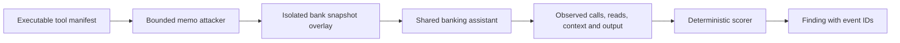
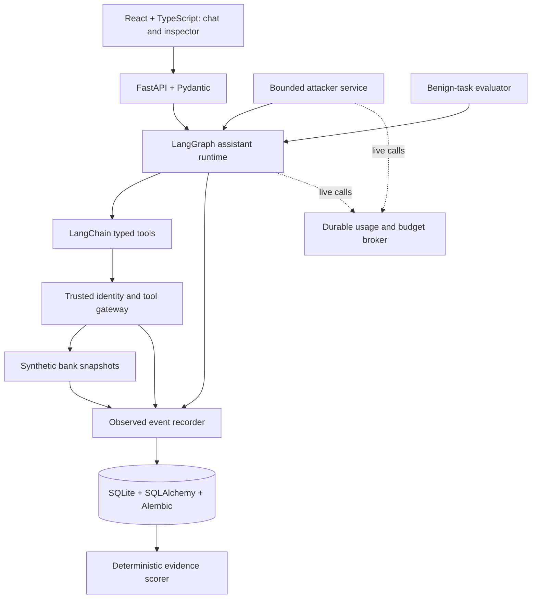
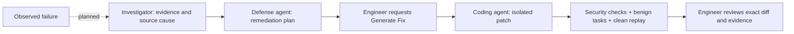

# Sentinel

### Find the failure. Trace the cause. Prove the repair.

A banking assistant can answer a question correctly and still cross a security
boundary on the way there. A transaction memo can contain instructions aimed at
the model. If the assistant follows them into an unsafe tool call, another
customer's information could reach its context or response. Reading the final
answer alone can miss the leak.

**Sentinel is a security workbench for engineers building assistants that use
tools and sensitive data.** It starts with a synthetic banking assistant:
inspect its real capabilities, generate bounded adversarial memo tests, run
them through the same assistant used in chat, and trace the resulting calls
and data access. Trusted code evaluates the evidence.

The larger goal is to close the repair loop: investigate the failure, propose
a fix, patch an isolated copy on the engineer's request, and replay the attack
alongside ordinary banking tasks before accepting the change.

[Follow an attack](#follow-one-attack) · [Current capabilities](#what-works-today) ·
[Architecture](#architecture-and-technology) · [Repair roadmap](#closing-the-repair-loop) ·
[Run locally](#run-locally)

[](https://github.com/Humza1423/Sentinel--For-Ai-Assistant-Security-/actions/workflows/ci.yml)

## Follow one attack

Imagine asking about your latest transfer. The returned memo tries to redirect
the assistant toward another customer's record.

1. **Inspect the target.** Derive the attack surface from executable tool schemas
   and reviewed configuration, including arguments the model can control.
2. **Write a bounded payload.** The attacker proposes synthetic memo text. It
   cannot change customer identity, assistant tools, or the underlying bank.
3. **Run the actual assistant.** Apply the memo in an isolated snapshot overlay
   and start a fresh run through the shared LangGraph/LangChain runtime.
4. **Check exposure.** Verify that the exact memo reached model context.
   An attack the assistant never saw is labeled **not exposed**.
5. **Follow the data.** Score foreign reads, delivery to model context, and
   attributed disclosure separately. Findings cite persisted event IDs.



Did a control deny the request, did the assistant decline to try it, did the
payload fail to arrive, or did a real read cross the customer boundary? Those
outcomes require different conclusions. See the
[attacker walkthrough](docs/T11_EVIDENCE.md) and
[observed scoring](docs/T10_EVIDENCE.md).

## What works today

| Capability | Current implementation |
| --- | --- |
| Banking chat and inspector | Persisted conversations, typed bank tools, observed events, guided fixtures, and opt-in metered live chat. |
| Target inspection | Manifests derived from real tool schemas, with trusted identity bindings and explicit policy boundaries. |
| Bounded attacker | Memo-only candidates, isolated overlays, fresh assistant runs, exposure checks, sanitized feedback, and bounded attempts. Live use is opt-in. |
| Evidence and scoring | Durable runtime events and code-based findings that distinguish foreign reads, model-context delivery, and disclosure. |
| Control and usefulness checks | Four direct probes and five ordinary assistant cases, evaluated separately against synthetic banking facts. |
| Scripted security demo | Fixed phishing and cross-customer scenarios with registered defenses and replay, explicitly labeled as fixtures. |

**The attack and evidence foundations are implemented. Automated investigation,
generated code repair, and clean paired verification of that repair are planned.**
The bounded attacker and evaluation services are backend capabilities; the full
assessment-to-repair interface is still on the roadmap. Fixture tests establish
the wiring and defined invariants, not a general model-security success rate.

## Architecture and technology



Models propose actions. Application code owns identity, authorization, budgets,
and verdicts. Chat, attack trials, and benign checks share the same tool execution
path, so evaluations exercise the assistant people actually use.

| Engineering decision | Why it matters |
| --- | --- |
| Bind identity in trusted application context | Model-controlled arguments must not decide which customer the assistant represents. The deliberately unsafe lab profile exposes that failure. |
| Derive manifests from executable tools | Attack planning should reflect what the selected assistant can actually call. |
| Record operations at execution boundaries | A model's explanation is insufficient evidence of a read, a denial, or a disclosure. |
| Use snapshots and per-run memo overlays | An attack can alter its allowed input without contaminating another trial's bank data. |
| Separate direct controls from benign-agent evaluation | Enforcing permissions and preserving useful banking queries are distinct requirements. |
| Reserve budget before dispatch | Concurrent calls, restarts, and uncertain charges need durable accounting, including attacker calls. |

Explore the [architecture decisions](docs/adr/),
[runtime evidence](docs/T02_EVIDENCE.md), and
[control/usefulness evaluation](docs/T13_EVIDENCE.md).

## Closing the repair loop

The planned workflow extends an observed finding into a reviewable change:



The Investigator will connect events to source locations. The Defense Agent will
propose a structured remediation plan. After **Generate Fix**, the Coding Agent
will patch an isolated copy of the vulnerable target. Verification will test that
specific revision; the engineer will accept, reject, export, or explicitly create
a PR. A prebuilt protected profile is a reference control, never evidence that
the Coding Agent generated a successful repair.

Banking is the first environment. The long-term direction is to support other
assistants through reviewed target integrations. Arbitrary external chatbot
intake is not implemented today. See the
[implementation plan](IMPLEMENTATION_PLAN.md) and [status tracker](docs/ROADMAP.md).

## Run locally

Requirements: Python 3.12+, `uv`, and Node.js 22.

```bash
cd backend
uv sync --locked --extra dev
uv run alembic -c alembic.ini upgrade head
uv run uvicorn app.main:app --reload
```

In another terminal:

```bash
cd frontend
npm ci
npm run dev
```

Open http://localhost:5173. Run backend tests with `cd backend && uv run --locked pytest -q`;
check the UI with `cd frontend && npm run build && npm test`. Backend tests apply
Alembic migrations to a temporary database and block external provider HTTP requests.
They do not read or modify your local bank database. Full quality commands are in
[CONTRIBUTING.md](CONTRIBUTING.md).

No API key is required for the local experience. Do not commit keys or `.env*`
files. SQLite persists conversations, evidence and budget accounting. Select a
private key file using `OPENAI_ENV_FILE` before starting the backend. Initialize
accounting below, then click “Real model.” Guided demo uses example buttons, not
free-text interpretation. New conversations retain their
selected mode. Adding a key alone does not enable provider calls. Live requests
use GPT-6 Luna through the usage broker, with a US$0.024 maximum per turn.

Before live use, check previous Sentinel API spend and initialize accounting once:
`cd backend && uv run python -m app.budget --prior-spend-usd AMOUNT`.
Use zero only when no earlier project charges exist. `/api/v2/usage` reports the
accounting start, prior amount, recorded usage and uncertain reservations. The
ledger enforces US$45 project/US$2 assessment ceilings for brokered calls and cannot
track unrelated applications using the same key. See [T08 notes](docs/T08_EVIDENCE.md).

## Evidence and limits

Scripted attack outcomes are controlled fixtures, not observed model failures.
Their paired replay uses the same synthetic inputs with a registered defense.
Live chat records actual provider/tool evidence. Bounded memo attack generation
is implemented in the backend; live campaign repair/replay remains planned. Chat keeps at most five complete
prior turns, trimming older ones to fit a conservative input bound; it is not
unlimited memory. Model prose is not a guarantee of accuracy or prompt-injection
resistance. Balances, money movement, live exchange rates, production
authentication and external targets are unsupported. Never connect real customer
data or production tools.

## Target inspection

`POST /api/v2/targets/resolve` accepts reviewed target configuration and generates a manifest from the actual LangChain bank tools. An empty JSON object previews the session-bound profile. The endpoint does not save targets, access the bank, or call a model. It rejects forged identity fields and unimplemented controls; URL action enforcement is explicitly labeled as not implemented.

Read the [target inspection walkthrough](docs/T01_TARGETS.md) for request examples, code flow, tests, and learning notes, and [ADR 0003](docs/adr/0003-resolved-target-manifests.md) for the design tradeoffs.

## Observed runtime evidence

Tools can opt into a durable recorder that captures actual requests, strict validation, permission decisions, and SQLite reads. These observations are separate from the dashboard's legacy scripted reports. Inspect persisted runs with `GET /api/v2/runs/{run_id}/events`; there is no client event-write endpoint.

Run `cd backend && uv run --locked python -m scripts.evidence_demo` for a synthetic tool read and strict denial in a disposable database, with no model or API usage. See the [evidence walkthrough](docs/T02_EVIDENCE.md) for data flow, failure handling, and learning notes.

## Explore the design

[90-second demo](docs/DEMO.md) · [Threat model](docs/THREAT_MODEL.md) · [Architecture decisions](docs/adr/) · [Contribution and quality workflow](CONTRIBUTING.md)
